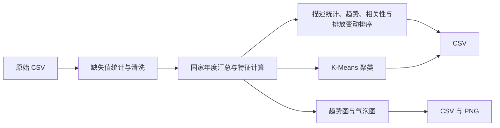

# 可再生能源与碳排放趋势分析

> 一条命令完成原始数据清洗、国家年度汇总、排放趋势分析与 K-Means 聚类，生成 12 份 CSV 和 3 张图表。

## 项目简介

本项目将可再生能源与碳排放的 Notebook 分析整理为可重复运行的 Python 流程。以国家和年份为分析粒度，查看排放变化与可再生能源占比，并对 2020–2024 年的排放变动进行排序。

| 功能 | 说明 |
| --- | --- |
| 数据清洗 | 统计字段缺失值，剔除含缺失值的记录，按国家和年份汇总 |
| 特征计算 | 计算排放强度、可再生能源占比的年变化率，以及聚类相关特征的 Z 分数 |
| 趋势与相关性 | 计算各国排放趋势的线性回归斜率，以及可再生能源占比与排放年增长率的相关系数 |
| 图表与对比 | 绘制总体趋势、2024 年 GDP 与排放气泡图，以及三个国家标识的趋势对比 |
| K-Means 聚类 | 使用人均碳排放、可再生能源占比增长率和排放强度划分 4 个簇，输出各簇平均排放和平均可再生能源占比 |

## 数据说明

原始输入为 [data/raw/data.csv](data/raw/data.csv)，包含 **200,000 行、8 列**，年份范围为 **2000–2024 年**，共 **200 个国家标识**。

| 字段 | 含义 |
| --- | --- |
| `country`、`year`、`region` | 国家标识、年份和区域 |
| `co2`、`co2_per_capita` | 二氧化碳排放总量和人均排放量 |
| `renewable_share` | 可再生能源占比 |
| `population`、`gdp` | 人口和国内生产总值 |

国家以 `Country_001` 等标识记录，仓库未附真实国名映射、数据来源或单位说明。清洗阶段沿用原 Notebook 对 `co2` 除以 10 的处理。总体趋势中的可再生能源占比按国家取算术平均，相关系数用于描述统计关联。

## 处理流程



## 快速开始

以下命令适用于 Windows PowerShell。项目已在 Python 3.13 下验证，依赖为 pandas、SciPy、scikit-learn 和 Matplotlib。

```powershell
git clone https://github.com/Qian-Bo-Han/renewable-energy-co2-analysis.git
Set-Location renewable-energy-co2-analysis

python -m venv .venv
.\.venv\Scripts\python.exe -m pip install -r requirements.txt
.\.venv\Scripts\python.exe main.py
```

运行结束后，程序将结果写入 `output/processed/` 和 `output/reports/`。两个目录由程序自动创建，生成文件通过 `.gitignore` 留在本地。

## 目录结构

```text
renewable-energy-co2-analysis/
├── .gitignore
├── README.md
├── main.py                         # 统一运行入口
├── requirements.txt                # Python 依赖
├── data/
│   └── raw/data.csv                # 原始输入
├── src/
│   └── renewable_pipeline/
│       ├── __init__.py
│       ├── pipeline.py             # 编排各分析阶段
│       ├── preprocess.py           # 清洗、汇总与特征计算
│       ├── analysis.py             # 描述统计、趋势、相关性与排序
│       ├── reports.py              # 图表与绘图数据
│       └── clustering.py           # K-Means 与分簇汇总
└── output/                         # 运行后生成
    ├── processed/                  # 12 份 CSV
    └── reports/                    # 3 张 PNG
```

## 输出结果

| 文件（位于 `output/processed/`） | 内容 |
| --- | --- |
| `001missing_summary.csv` | 字段缺失值统计 |
| `002cleaned_data.csv` | 清洗后的记录 |
| `003merged_data.csv` | 按国家和年份汇总的数据 |
| `004processed_data.csv` | 排放强度、可再生能源占比增长率及 Z 分数 |
| `005processed_data.csv` | 各国排放、人均排放及可再生能源占比的描述统计 |
| `006country_data.csv` | 各国碳排放趋势的线性回归斜率 |
| `007correlation.csv` | 各国可再生能源占比与排放年增长率的相关系数 |
| `009global_trends.csv` | 各年度的排放合计和国家占比均值 |
| `010map_data.csv` | 2024 年气泡图数据 |
| `011combo_data.csv` | 三个国家标识的对比数据 |
| `012top_reduction.csv` | 按 2024 年减去 2020 年的排放变化量升序排列的前五项 |
| `013cluster_summary.csv` | 各簇平均排放和平均可再生能源占比 |

`output/reports/` 包含 `global_trends.png`（年度总体趋势）、`map_2024.png`（2024 年 GDP 与碳排放气泡图）和 `combo_chart.png`（三个国家标识的趋势对比）。
